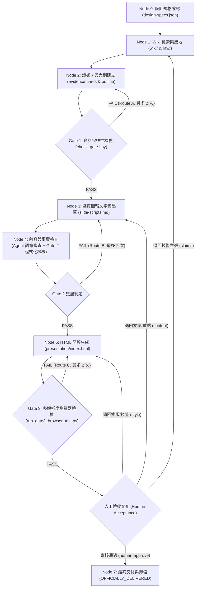

# 數位音樂與音質：LLM Wiki 知識庫 ＆ 12 頁教學簡報
> **Digital Audio & Sound Quality: LLM Wiki & Interactive Presentation**

本專案依據 **Andrej Karpathy 的 LLM Wiki 構想** 構建，實現「底層權威知識庫」與「上層視覺簡報」的**解耦架構**。專案以 5 篇權威文獻為接地基礎，經由 Python 狀態機控制器驅動的 **Graph / Loop 工作流程**，打造出高度嚴謹接地、直覺親切且具備暖白文青黑白手繪 Doodle 風格的 12 頁互動式 HTML5 教學簡報。

---

## 🌟 核心特點與亮點

1. **知識庫與展示層徹底解耦**：
   * `wiki/` 保持純淨結構化知識，不參雜簡報排版代碼或特效，作為單一事實來源（Single Source of Truth）。
   * `presentation/index.html` 為純原生獨立 HTML5 簡報，不依賴外部龐大框架，具備即時鍵盤導航、進度條、講稿備註抽屜與真實來源跳轉。
2. **直覺通俗、無晦澀公式**：
   * 專為無音訊工程背景的音樂愛好者設計，用「每秒拍照影格率」解釋取樣率，用「量身高的尺刻度」解釋位元深度，用「強音遮蔽弱音」解釋有損壓縮，破解 Hi-Res 與階梯鋸齒波形迷思。
3. **Graph / Loop 狀態機與自動化品質門禁（Quality Gates）**：
   * 嚴格劃分 Python 控制器（負責門禁、狀態流轉與重試上限）與 Agent（負責實質工件編修）的協同邊界。
   * 內建三大自動化驗證關卡（Gate 1、Gate 2、Gate 3），支援自動退回修正循環（上限 2 次），並設置嚴格的人工驗收守衛機制。

---

## 🚀 快速開始與簡報存取入口

* **線上直接瀏覽（GitHub Pages）**：
  * **首頁與 Wiki 導覽**：[https://Shyluck-L.github.io/music-audio-wiki/](https://Shyluck-L.github.io/music-audio-wiki/)
  * **簡報正式入口**：[https://Shyluck-L.github.io/music-audio-wiki/presentation/](https://Shyluck-L.github.io/music-audio-wiki/presentation/)
* **本機直接開啟**：
  * 雙擊開啟 `presentation/index.html` 即可立即全螢幕播放簡報。
  * 快捷鍵支援：`←` / `→`（上一頁／下一頁）、`Home` / `End`（首頁／尾頁）、點選右上角「講稿備註」可呼叫補充講解抽屜。

---

## 📁 專案目錄結構

```text
music-audio-wiki/
├── .gitignore                   # Git 排除暫存快取清單
├── .nojekyll                    # 停用 GitHub Pages Jekyll 渲染，保持原生路徑
├── AGENTS.md                    # Agent 維護規範、嚴格接地守則與單頁標準模板
├── README.md                    # 專案總覽與架構說明文件（本文件）
├── index.html                   # GitHub Pages 入口首頁（簡報引導與知識庫導覽）
├── index.md                     # Wiki 全域導覽目錄、分類條目地圖與推薦閱讀順序
├── log.md                       # 歷次 Ingest、工作流執行與人工驗收累積日誌
├── presentation/
│   └── index.html               # 最終正式交付之 12 頁手繪 Doodle 互動簡報
├── raw/                         # 清洗後之權威原始資料（iZotope, MDN, Xiph, Apple）
│   ├── 01-izotope-digital-audio-basics.md
│   ├── 02-mdn-digital-audio-concepts.md
│   ├── 03-mdn-audio-codecs.md
│   ├── 04-xiph-flac.md
│   └── 05-apple-lossless-audio.md
├── wiki/                        # 提煉後的結構化知識庫（11 篇）
│   ├── concepts/                # 核心概念（取樣率、位元深度、位元率、壓縮原理）
│   ├── formats/                 # 音訊格式（MP3、AAC、FLAC、ALAC）
│   ├── comparisons/             # 橫向對比（有損 vs 無損、Apple Music 設備限制）
│   └── myths/                   # 迷思破解（高規格音質與鋸齒波迷思）
├── scripts/
│   ├── lint.py                  # Wiki 知識庫品質檢驗腳本（無孤立頁、無死連結、有來源）
│   └── workflow.py              # Central Graph/Loop 狀態機控制器（含重試上限與狀態守衛）
└── scratch/                     # 中間核心工件與 Gate 檢驗腳本
    ├── check_gate1.py           # Gate 1: 證據卡與大綱結構檢驗
    ├── check_gate2.py           # Gate 2: 文字稿格式與關鍵事實檢驗
    ├── run_gate3_browser_test.py # Gate 3: Headless Chrome 多解析度渲染與 SVG 邊界量測
    ├── design-specs.json        # Node 0 設計規格定稿檔
    ├── evidence-cards.json      # Node 2 逐頁來源證據卡
    ├── slide-outline.md         # Node 2 12 頁簡報大綱
    ├── slide-scripts.md         # Node 3 逐頁文字稿（正式交付定稿版）
    └── workflow-state.json      # 當前工作流狀態機持久化檔案
```

---

## 🔄 Graph / Loop 工作流架構

本專案遵循嚴格的 8 節點有向循環圖（State Machine Graph），透過 Python 控制器進行防呆與狀態守衛：



### 三大門禁（Quality Gates）檢驗機制

1. **Gate 1：資料完整性與來源路徑檢核 (`scratch/check_gate1.py`)**
   * 驗證 12 頁大綱與證據卡存在性。
   * 檢查每張卡片皆包含清晰主張、白話比喻、Wiki 連結與 Raw 原始文獻定位。
2. **Node 4 內容與事實檢查 ＆ Gate 2 檢驗機制**
   * **Agent AI 語意事實審查**：逐頁核對文字稿與簡報中的客觀技術主張、數值、比例是否均有 Wiki 與 Raw 的直接依據，檢驗是否有未經標註的外部推論、過度肯定或數據混淆。
   * **Gate 2 程式化結構檢核 (`scratch/check_gate2.py`)**：自動驗證金句、解析、生活類比（標註 `[補充說明]`）、視覺指引與來源齊全度，確保篇章結構完備。
3. **Gate 3：多解析度瀏覽器畫面與功能檢核 (`scratch/run_gate3_browser_test.py`)**
   * 啟動本機 Headless Chrome，在 **720p（1280×720）**、**1080p（1920×1080）** 及 **筆電常見（1366×768）** 三種解析度下渲染。
   * 驗證全 12 頁在目標解析度下無文字溢出、無內部捲動，且鍵盤導航功能測試正常。
   * 專項量測：透過 Chrome DevTools `getBBox()` 實測第 8 頁 SVG 標籤文字邊界，實測左右邊距具備充裕空間（> 62px），符合無貼邊與包覆標準。

---

## 🛠️ 控制器指令與重現方式

專案內建命令列工具，可隨時檢驗專案健康度與工作流狀態：

```bash
# 1. 檢視當前工作流狀態、節點與重試計數
python scripts/workflow.py status

# 2. 一鍵執行全流程自動檢驗清單 (Lint + Gate 1 + Gate 2 + Gate 3)
python scripts/workflow.py check-all

# 3. 獨立執行各項檢驗
python scripts/lint.py                     # Wiki 規格檢測
python scratch/check_gate1.py              # Gate 1 檢驗
python scratch/check_gate2.py              # Gate 2 檢驗
python scratch/run_gate3_browser_test.py   # Gate 3 瀏覽器實際檢驗
```

---

## 📄 簡報 12 頁目錄大綱一覽

* **模組一：聲音的數位化基礎**
  * 第 1 頁｜**獨立封面**：我們每天聽的數位音樂，到底是什麼？
  * 第 2 頁｜**取樣率**：電腦每秒對聲音「拍幾次照」？
  * 第 3 頁｜**位元深度**：量測音量大小的「尺」有多精細？
  * 第 4 頁｜**為什麼音樂需要壓縮？**：一首歌竟然有 34.5 MB！
* **模組二：壓縮的魔法與格式對決**
  * 第 5 頁｜**有損壓縮**：聰明騙過耳朵的減重術
  * 第 6 頁｜**無損壓縮**：完好如初的收納拉鍊
  * 第 7 頁｜**常見有損格式大比拼**：MP3 vs. AAC
  * 第 8 頁｜**常見無損格式雙雄**：FLAC vs. ALAC
* **模組三：實戰決策與迷思破解**
  * 第 9 頁｜**實務決策**：日常聽歌，我真的需要「無損」嗎？
  * 第 10 頁｜**破解迷思**：追求 Hi-Res 24-bit / 192 kHz，真的有神效嗎？
  * 第 11 頁｜**迷思破解**：戴 AirPods 聽無損，為什麼聽起來沒差？
  * 第 12 頁｜**總結**：找回聽音樂的感動（影響音質的三大核心平衡）
